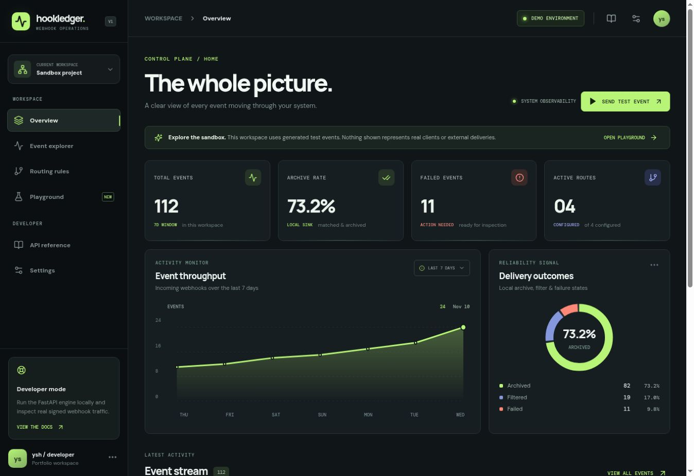
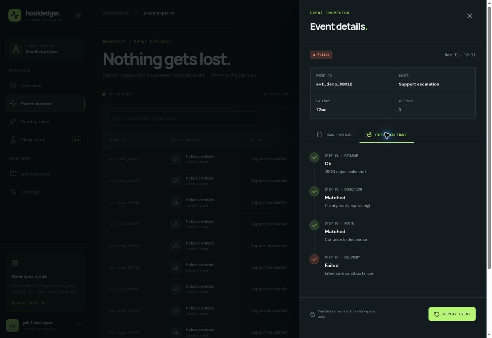
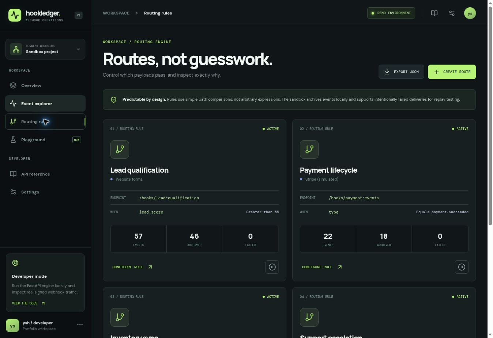
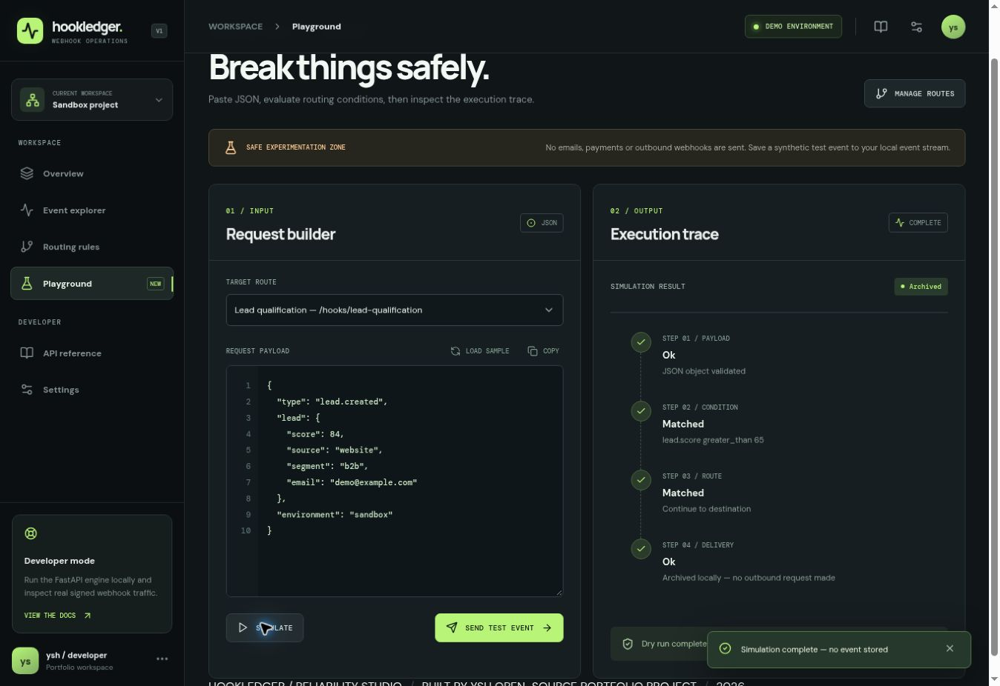
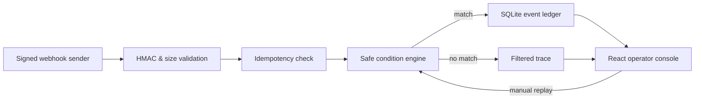

<div align="center">


# HookLedger

### Webhook reliability, without the guesswork.

**A local-first webhook operations console with a real Python API, rule-based routing, HMAC verification, idempotent ingestion, execution traces, and replayable failures.**

[Live interactive sandbox](https://hookledger-webhook-studio.vercel.app) · [Interface screenshots](#interface-screenshots) · [Architecture](docs/ARCHITECTURE.md) · [API reference](docs/API.md) · [Security model](docs/SECURITY.md)

[](https://github.com/fbccsz/hookledger-webhook-studio/actions/workflows/ci.yml)


</div>

---

## Why this project exists

Webhook integrations fail in ways that are difficult to reproduce: duplicate deliveries, malformed JSON, invalid signatures, rule mismatches, and downstream delivery failures. Small automation projects often have no dedicated way to inspect an event's path or understand exactly why it didn't work.

HookLedger is a **developer-focused reliability laboratory** for that problem. It combines a complete interactive UI with a backend demonstrating the fundamental engineering patterns behind dependable automation.

It is intentionally different from a generic SaaS dashboard: **the domain logic is implemented, tested, and observable**.

## Interface

> The hosted application is a fully interactive **sandbox with generated data**. It is *not* connected to real customer accounts or external payment processors. Changes persist in the visitor's browser.
>
> The demo is deployed from the GitHub repository using Vercel Git integration. Changes to `main` can trigger a fresh build; only the frontend is hosted.

### Interface screenshots

Real captures of the [live sandbox](https://hookledger-webhook-studio.vercel.app/) on **November 11, 2026**, using only the project's built-in fictional events and routes.

**Operations overview** — event metrics, throughput and outcome breakdown.



<details>
<summary><strong>Event inspection and execution trace</strong></summary>

The Event explorer is filtered to failed sandbox events. The inspector shows payload validation, condition matching, route selection and the intentional failure in the demo delivery mode.



</details>

<details>
<summary><strong>Conditional routing rules</strong></summary>

Configured routes expose their endpoints, comparison conditions and event counters.



</details>

<details>
<summary><strong>Playground and dry-run result</strong></summary>

A sample lead payload is evaluated against the qualification rule. The dry run shows every evaluation step without storing an event or forwarding a request.



</details>

[Capture details and reproduction steps](docs/screenshots/README.md).

### What you can do

| Capability | Interactive sandbox | Python backend |
| --- | :---: | :---: |
| Analytics and event history | ✅ Synthetic event stream | ✅ SQLite records |
| Event search, filters, payload inspector | ✅ | ✅ Authenticated API |
| Conditional route configuration | ✅ | ✅ Validated rule CRUD |
| Safe JSON dry-run | ✅ | ✅ `POST /api/simulate` |
| Failure injection | ✅ Configurable sandbox mode | ✅ Intentional failure mode |
| Replay with execution trace | ✅ | ✅ Up to 10 attempts |
| Idempotency keys | Demonstrated in fixtures | ✅ Unique per-route constraint |
| HMAC-SHA256 webhook verification | — | ✅ Optional secret, fail-closed |
| Admin bearer authentication | — | ✅ Required |
| JSON configuration / event CSV export | ✅ | JSON API responses |
| Outbound third-party forwarding | **Not implemented** | **Not implemented** |

### Routes included in the sandbox

- **Lead qualification** — accept payloads based on a numeric score.
- **Payment lifecycle** — match a named event type (synthetic only).
- **Inventory sync** — filter low-quantity updates.
- **Support escalation** — intentionally fail, update routing, then replay.

All businesses, identities, scores and payloads in the sandbox are fictional. Event status **Archived** means locally stored, **not delivered to another provider**.

## Technology

**Frontend:** React 18, TypeScript, Vite, Lucide, native SVG charts, CSS with responsive dark design. No component kit or charting library.

**Backend:** Python 3.11+, FastAPI, Pydantic v2, standard-library SQLite and `hmac`, pytest/TestClient.

**Engineering:** pure rule engine, explicit execution traces, per-route idempotency, HMAC verification, bounded replay, fail-closed signature mode, CI for frontend/backend.

## Quick start

### 1. Interactive UI (demo mode)

```bash
cd frontend
npm install
npm run dev
```

Visit `http://localhost:5173`. The UI works independently of the Python backend; it stores sandbox changes in localStorage and does not issue real webhook requests.

### 2. Python API

```bash
cd backend
python -m venv .venv
source .venv/bin/activate  # Windows: .venv\Scripts\activate
pip install -r requirements.txt
```

Copy `backend/.env.example` to your own local configuration or set the variables in your shell. **Do not commit the values.**

```bash
export HOOKLEDGER_ADMIN_TOKEN="replace-with-a-strong-random-token-at-least-20-characters"
export HOOKLEDGER_WEBHOOK_SECRET="replace-with-an-independent-HMAC-secret"
export HOOKLEDGER_DB_PATH="./hookledger.db"
uvicorn hookledger.main:app --reload
```

Then open `http://localhost:8000/docs` for the OpenAPI reference.

### 3. Configure a route

```bash
curl -X POST http://localhost:8000/api/routes \
  -H "Authorization: Bearer $HOOKLEDGER_ADMIN_TOKEN" \
  -H 'Content-Type: application/json' \
  -d '{
    "title":"Lead qualification",
    "slug":"lead-qualification",
    "source":"Website forms",
    "field":"lead.score",
    "operator":"greater_than",
    "expected":"65",
    "delivery_mode":"archive",
    "enabled":true
  }'
```

### 4. Send a signed event

```bash
export HOOKLEDGER_WEBHOOK_SECRET="the-same-secret-configured-in-the-server"
python scripts/demo_sender.py --route lead-qualification
```

Or follow the cURL example in [the API guide](docs/API.md). The Python sender computes the HMAC from the exact request bytes and uses an idempotency key.

### 5. Connect the UI to FastAPI

In the UI, open **Settings → Connect your backend** and enter `http://127.0.0.1:8000` with your admin token. When connected, routes, events, metrics and replay operations use the backend instead of the local sandbox. The token remains in memory only and is cleared on reload.

**Do not paste production secrets into a publicly hosted demo.** Run the UI locally when testing your API.

## Running tests

```bash
cd backend
pip install -r requirements-dev.txt
PYTHONPATH=. pytest -q

cd ../frontend
npm install
npm test
npm run build
```

CI executes both test suites and the frontend build in GitHub Actions. Tests cover signature rejection, authorization, matching/filtering, HMAC verification, idempotency, malformed input, simulation without persistence, replay, route constraints, and aggregate metrics.

## Security boundaries

The default backend **rejects unsigned webhook requests**. If no `HOOKLEDGER_WEBHOOK_SECRET` is configured, incoming requests fail unless `HOOKLEDGER_ALLOW_UNSIGNED=1` is deliberately set in an isolated local-development environment.

- Admin API requires a bearer token set through an environment variable.
- Only validated, bounded JSON objects are accepted (64 KiB max).
- Signature validation uses constant-time HMAC comparison.
- Idempotency is enforced with a unique SQLite constraint and a write transaction.
- Routing expressions are deliberately restricted; no `eval` or code execution.
- The public demo does not receive real webhooks, perform external requests, or handle sensitive production data.

This is an educational and portfolio implementation, **not a production-ready multitenant webhook service**. Before production deployment, add TLS termination, per-tenant authorization, secret vault, background queues, outbound destination allowlists, data retention policies, structured logs, distributed rate limiting, monitoring and backups. See [SECURITY.md](docs/SECURITY.md).

## Architecture



The hosted UI runs only the front-end sandbox. The FastAPI service runs separately during local development. Real external destination delivery is intentionally out of scope. More details: [Architecture notes](docs/ARCHITECTURE.md).

## Commercial relevance

This is a portfolio response to recurring patterns in real freelance requests: webhook validation, API integrations, logs, duplicate prevention and operational dashboards. The product is original and does not copy those listings. Sources and scope decisions are documented in [PROJECT_BRIEF.md](docs/PROJECT_BRIEF.md).

## Project structure

```text
hookledger/
├── backend/
│   ├── hookledger/
│   │   ├── main.py          # FastAPI routes, auth, HMAC, replay
│   │   ├── db.py            # SQLite schema and transactions
│   │   └── engine.py        # Pure routing conditions
│   ├── tests/               # Python integration tests
│   └── scripts/demo_sender.py
├── frontend/
│   ├── src/App.tsx          # Operator experience
│   ├── src/core/            # Typed rule engine + state
│   ├── src/data/            # Explicitly synthetic fixtures
│   └── src/styles.css      # Bespoke responsive UI
├── docs/                    # Design, API and security
├── .github/workflows/       # CI
└── LICENSE
```

---

<div align="center">

**Designed and developed by `ysh` · 2026**  
Open-source portfolio implementation under the MIT License.

</div>
